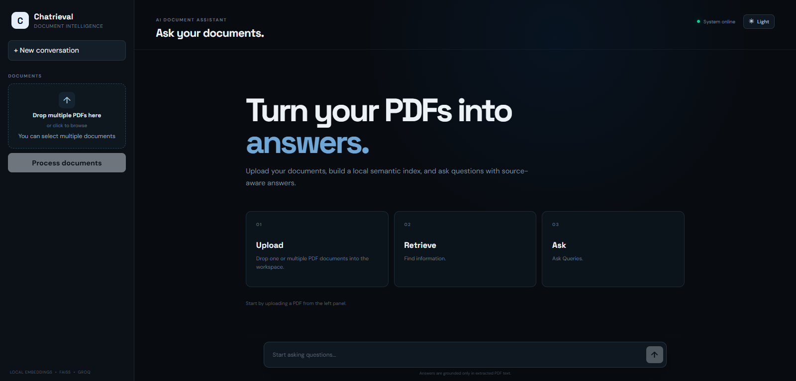
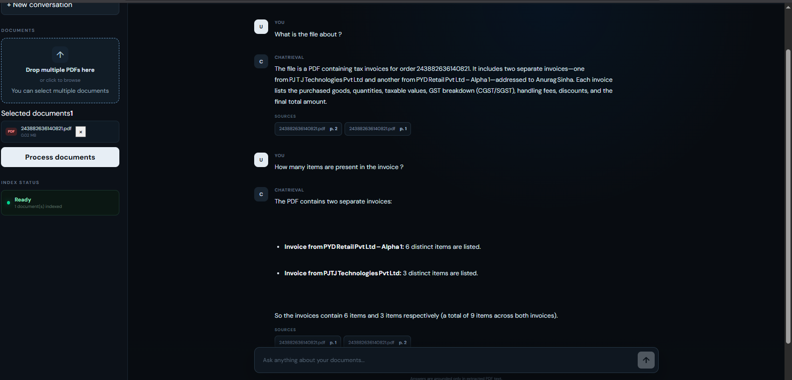

# Chatrieval

Full-stack RAG based AI PDF assistant using React, Vite, FastAPI, local MiniLM embeddings, FAISS, and Groq GPT-OSS 120B.

## Screenshots

### Main Interface



### Chat



## Architecture

```text
React + Vite
     |
     | REST API
     v
FastAPI
     |
     +--> PyPDF2 --> Chunking --> MiniLM --> FAISS
     |
     +--> Retrieved chunks --> Groq GPT-OSS 120B --> Answer + sources
```


## Prerequisites

- Python 3.10+
- Node.js 20.19+ (current Vite requirement)
- npm
- Groq API key

## Backend

```powershell
cd backend
python -m venv venv
venv\Scripts\activate
pip install -r requirements.txt
copy .env.example .env
```

Edit `.env`:

```text
GROQ_API_KEY=your_groq_api_key
GROQ_MODEL=openai/gpt-oss-120b
```

See `backend/.env.example` for the optional settings (allowed origins, upload limits, session expiry).

Start:

```powershell
uvicorn main:app --reload
```

API: `http://127.0.0.1:8000`
Docs: `http://127.0.0.1:8000/docs`

## Frontend

Open another terminal:

```powershell
cd frontend
npm install
npm run dev
```

Open `http://localhost:5173`.

## Deployment

The frontend and backend deploy separately.

### Backend (Docker)

Embeddings run through ONNX Runtime (`fastembed`) rather than PyTorch, so the image is small and fits free-tier hosts. The MiniLM model is downloaded at build time.

Sessions are kept in memory, so run a **single worker** (the Dockerfile does).

**Render:** create a new Blueprint from this repo (it reads `render.yaml`), then set `GROQ_API_KEY` and `ALLOWED_ORIGINS` (your frontend URL, no trailing slash).

**Hugging Face Spaces / Fly.io / Railway:** build `backend/Dockerfile`; it listens on `$PORT` (default 7860). Set the same environment variables.

Health check: `GET /api/health`.

### Frontend (Vercel)

1. Import the repo and set the **Root Directory** to `frontend`.
2. Add the environment variable `VITE_API_URL` = your backend URL.
3. Deploy. Then make sure the backend's `ALLOWED_ORIGINS` contains the Vercel URL.

Free hosts sleep when idle, so the first request after a pause can take 30-60 seconds.

